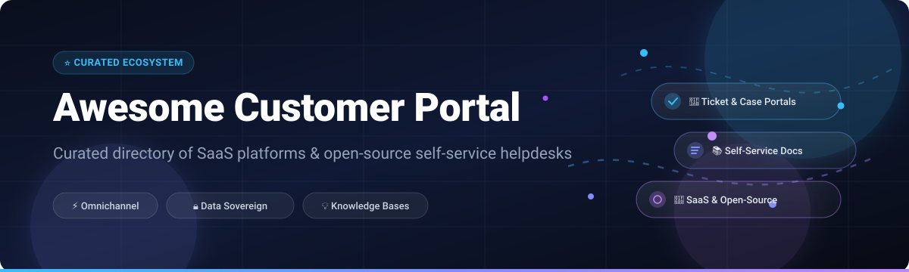
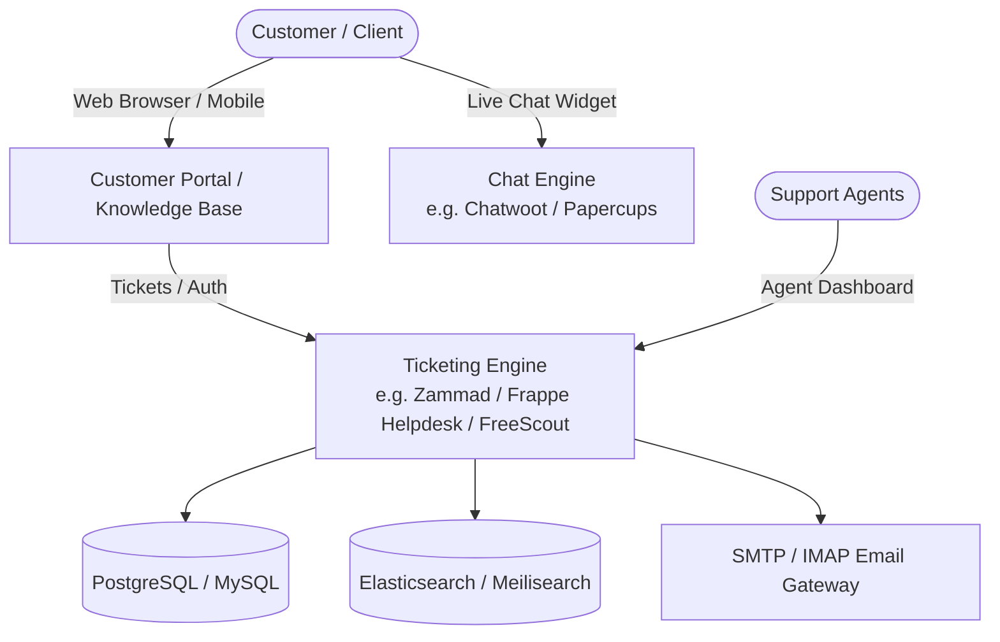

# 🌟 Awesome-Customer-Portal 🚀

  
  
  
  
  
  

  <b>A curated catalog of premier SaaS Customer Portals, self-service knowledge bases, and open-source helpdesk solutions.</b>

---

## 📖 Table of Contents

- [📊 Sector Overview & Market Dynamics](#-sector-overview--market-dynamics)
- [☁️ SaaS & Hosted Customer Portals](#️-saas--hosted-customer-portals)
- [🔓 Open-Source Customer Portals & Helpdesks](#-open-source-customer-portals--helpdesks)
- [🏗️ Architecture & Self-Hosting Stack](#️-architecture--self-hosting-stack)
- [⚖️ How to Choose: SaaS vs. Open-Source](#️-how-to-choose-saas-vs-open-source)
- [📈 Star History](#-star-history)
- [💖 Support & Sponsorship](#-support--sponsorship)
- [🤝 Contributing](#-contributing)
- [📜 Disclaimer](#-disclaimer)

---

## 📊 Sector Overview & Market Dynamics

The global customer self-service and support software market is valued at **$18 billion to $27 billion** (with the broader customer service CRM ecosystem exceeding **$55 billion**) and is growing at an accelerated **19%–22% CAGR**. 

Market concentration follows a **moderately fragmented yet top-consolidated distribution**: established cloud giants (Salesforce, HubSpot, Zendesk) dominate enterprise tiers, while an energetic ecosystem of specialized mid-market SaaS vendors and open-source self-hosted solutions thrive across privacy-conscious organizations, SMBs, and software engineering teams.

---

## ☁️ SaaS & Hosted Customer Portals

The following comparison table presents premier commercial customer portal platforms, sorted descending by company scale (market valuation / revenue).

| 🏢 Product / Platform | 💰 Company Scale (Valuation / Revenue) | 🏷️ Starting Pricing | 🎁 Free Tier / Trial Limits | ⚡ Key Features |
| :--- | :--- | :--- | :--- | :--- |
| **[Salesforce Service Cloud](https://www.salesforce.com/)** | ~$280B Market Cap (~$38B Annual Revenue) | $25/user/month (Starter Suite, billed annually) | 30-day free trial (full Starter Suite feature access; no credit card required) | Enterprise Experience Cloud-powered customer portal, unified CRM ticketing, omni-channel case routing, and customizable knowledge base. |
| **[HubSpot Service Hub](https://www.hubspot.com/)** | ~$32B Market Cap (~$2.6B Annual Revenue) | $15/seat/month (Starter tier, billed annually) | Free tier forever (up to 5 users, shared inbox, ticketing, 1 closed ticket automation, native reporting; 14-day trial for Professional) | Seamless CRM integration, customer portal with ticket tracking, knowledge base, feedback surveys, and omni-channel messaging. |
| **[Zendesk](https://www.zendesk.com/)** | ~$10.2B Valuation (Acquired by Hellman & Friedman) | $19/agent/month (Support Team tier, billed annually) | 14-day free trial (unrestricted access to Suite Team or Professional plans; no credit card required) | Category leader in help center knowledge bases, branded community forums, AI answer bots, and multi-brand portal management. |
| **[Freshdesk](https://freshdesk.com/)** | ~$4.2B Market Cap (Freshworks Inc.) | $15/agent/month (Growth tier, billed annually) | Free tier forever (up to 10 agents, email/social ticketing, ticket trend reporting, basic knowledge base; 14-day trial on Pro) | Multi-product customer portals, WCAG 2.0 AA-compliant themes, multi-theme customization, forum moderation, and ticket tracking. |
| **[Zoho Desk](https://www.zoho.com/desk/)** | ~$1.4B Annual Revenue (Zoho Corp, bootstrapped) | $14/agent/month (Standard tier, billed annually) | Free tier forever (up to 3 agents, email ticketing, private knowledge base, SLA macros; 15-day trial on Enterprise) | Multilingual customer portal (50+ languages), AI-powered Zia assist, embeddable ASAP portal widget, and work-flow automations. |
| **[Help Scout](https://www.helpscout.com/)** | ~$40M Annual Revenue (SMB Help Desk Leader) | $25/user/month (Standard tier, billed annually) | Free tier forever (up to 5 users, capped at 100 contacts/month, 1 inbox, 1 Docs site with up to 10 articles; 15-day trial on Standard/Plus) | Authenticated passwordless customer portal, organization-level ticket history, HIPAA compliance workflows, and embedded Docs widget. |
| **[Hiver](https://hiverhq.com/)** | ~$15M–$20M Annual Revenue (Series A) | $25/user/month (Growth tier, min 2 users, billed annually) | 7-day free trial (unrestricted access to top-tier Elite plan with 24/7 priority support; no credit card required) | Gmail-native shared inbox and customer portal, multi-channel support (email, chat, WhatsApp), and workflow SLA automations. |
| **[Deskpro](https://www.deskpro.com/)** | ~$10M–$15M Annual Revenue (Private) | $39/agent/month (Team tier, billed annually) | 14-day free trial (full Cloud or Self-Hosted evaluation; no credit card required) | Omnichannel helpdesk with dedicated client portal, known issues management, on-premise and cloud hosting options, and multi-brand setup. |
| **[HappyFox](https://www.happyfox.com/)** | ~$8M–$12M Annual Revenue (Private) | $26/agent/month (Mighty tier, billed annually) | 14-day free trial (full feature access for help desk evaluation; no credit card required) | Support Center v2 portal builder, multilingual self-service (39+ languages), widget-based customizable CSS/JS, and ticket automation. |
| **[SupportPal](https://www.supportpal.com/)** | ~$2M–$5M Annual Revenue (Private) | $24.95/month/brand (Unlimited operators license) | 30-day free trial (full self-hosted software license; no credit card required) | Self-hosted customer support platform billed per brand with unlimited operator seats, multi-channel ticket piping, and client portal. |

---

## 🔓 Open-Source Customer Portals & Helpdesks

Self-hosted, transparent, and data-sovereign helpdesk and customer portal projects on GitHub. Sorted descending by GitHub stargazers count.

| 📦 Project | ⭐ Stars | 🛠️ Tech Stack | 📄 License | 📝 Description |
| :--- | :--- | :--- | :--- | :--- |
| **[Chatwoot](https://github.com/chatwoot/chatwoot)** |  | Ruby on Rails, Vue.js | MIT | Omni-channel customer engagement platform with web live chat, help center knowledge base, multi-inbox management, and customer portal widgets. |
| **[UVdesk](https://github.com/uvdesk/community-skeleton)** |  | PHP (Symfony) | MIT | Modular open-source helpdesk system with a dedicated customer self-service portal, knowledge base, ticket management, and eCommerce connectors. |
| **[GLPI](https://github.com/glpi-project/glpi)** |  | PHP | GPL-3.0 | Comprehensive ITIL service desk and asset management platform featuring self-service user portal, ticket tracking, and knowledge base. |
| **[Papercups](https://github.com/papercups-io/papercups)** |  | Elixir, React | MIT | Open-source customer messaging platform with embeddable support chat widgets, Slack integration, and customer communication workflows. |
| **[Zammad](https://github.com/zammad/zammad)** |  | Ruby on Rails, PostgreSQL | AGPL-3.0 | Enterprise-ready web-based customer support system with dedicated customer portal, ticket tracking, knowledge base, and VoIP/telephony support. |
| **[FreeScout](https://github.com/freescout-help-desk/freescout)** |  | PHP (Laravel), MySQL | AGPL-3.0 | Lightweight, self-hosted Zendesk & Help Scout alternative with end-user portal modules, shared mailboxes, and extensive community extensions. |
| **[osTicket](https://github.com/osTicket/osTicket)** |  | PHP, MySQL | GPL-2.0 | Battle-tested and widely deployed open-source ticket system featuring client web portal, service level agreements (SLAs), and knowledge base. |
| **[Chaskiq](https://github.com/chaskiq/chaskiq)** |  | Ruby on Rails, React | GPL-3.0 | Conversational marketing and support messaging platform alternative to Intercom/Drift with integrated self-service knowledge base. |
| **[Frappe Helpdesk](https://github.com/frappe/helpdesk)** |  | Python (Frappe), Vue.js | AGPL-3.0 | Modern customer support tool built on the Frappe framework with dual customer and agent portals, SLA management, and knowledge base. |
| **[Peppermint](https://github.com/Peppermint-Lab/peppermint)** |  | Node.js, Express, React | MIT | Clean, modern ticket management and help desk solution designed as a lightweight open-source alternative to Jira Service Management. |
| **[Libredesk](https://github.com/abhinavxd/libredesk)** |  | Go, Svelte | AGPL-3.0 | Single-binary, lightweight self-hosted customer support desk with fast setup and low resource requirements. |
| **[Helpy](https://github.com/helpyio/helpy)** |  | Ruby on Rails | MIT | Mobile-friendly customer support desk featuring multi-channel ticketing, community forums, and self-service knowledge center. |
| **[Live Helper Chat](https://github.com/LiveHelperChat/livehelperchat)** |  | PHP, JavaScript | Apache-2.0 | Feature-rich live support chat platform with voice/video capabilities, customer portal integrations, and bot triggers. |
| **[django-helpdesk](https://github.com/django-helpdesk/django-helpdesk)** |  | Python (Django) | BSD-3-Clause | Django application for managing helpdesk tickets, client submissions, and basic knowledge base workflows. |
| **[Trudesk](https://github.com/polonel/trudesk)** |  | Node.js, MongoDB | Apache-2.0 | Real-time open-source helpdesk with ticketing, customer knowledge base, and live chat notifications. |
| **[Faveo Helpdesk](https://github.com/faveosuite/faveo-helpdesk)** |  | PHP (Laravel) | OSL-3.0 | Ticketing system built on Laravel with customer self-service portal, built-in knowledge base, and SLA management. |
| **[OpenSupports](https://github.com/opensupports/opensupports)** |  | PHP, React | GPL-3.0 | Open-source ticket system designed for clean customer portal ticket submissions, responses, and FAQ documentation. |
| **[Tiledesk](https://github.com/Tiledesk/tiledesk)** |  | Node.js, Angular | MIT | Open-source conversational AI and live-chat customer portal platform with omnichannel integrations and chatbot builders. |

---

## 🏗️ Architecture & Self-Hosting Stack

For organizations deploying their own self-hosted customer portal infrastructure, popular architectural patterns include:

---

## ⚖️ How to Choose: SaaS vs. Open-Source

| 🧭 Criterion | ☁️ SaaS Solutions | 🔓 Open-Source Solutions |
| :--- | :--- | :--- |
| **🚀 Deployment Speed** | Instant setup with managed hosting and automatic maintenance | Requires hosting infrastructure (Docker, VPS, Kubernetes) |
| **🔐 Data Privacy & Sovereignty** | Data stored in vendor cloud (check GDPR/HIPAA compliance) | Complete control over database and customer PII |
| **💵 Pricing Predictability** | Scales per-seat/agent; can grow costly with large teams | Flat hosting costs regardless of operator or customer seat count |
| **🎨 Customizability** | Theming via UI or CSS/JS widgets | Complete code-level access for custom themes, APIs, and plugins |
| **🛠️ Maintenance Burden** | Zero maintenance (handled by vendor) | Requires regular backups, security patch updates, and monitoring |

---

## 📈 Star History

---

## 💖 Support & Sponsorship

Thank you so much for exploring and using **Awesome-Customer-Portal**! ⭐

If you find this repository valuable, please consider supporting the project:
- 🌟 **Star the repository** to boost discoverability and help other developers.
- 🍴 **Fork the repo** to contribute your own favorite tools, customizations, and portals.
- 📢 **Share it** with fellow developers, DevOps teams, and customer support engineers!
- ☕ **Buy a coffee & sponsor**: If this project saved you hours of research, feel free to sponsor ongoing maintenance via the [Sponsor Dashboard](https://github.com/sponsors/ishandutta2007).

Every bit of encouragement and sponsorship keeps this open-source curation up-to-date and vibrant! 🙌

---

## 🤝 Contributing

Contributions are warmly welcome! To add or update platforms:

1. 🍴 Fork the repository.
2. 📝 Update [`README.md`](file:///C:/Users/ishan/Documents/Projects/Awesome-Customer-Portal/README.md) with factual data, official links, and GitHub star badges.
3. 🚀 Submit a pull request detailing your additions.

---

## 📜 Disclaimer

This is a community-curated list compiled for educational and comparative purposes. Product pricing, limits, and feature sets change over time; please verify with each vendor's official website prior to making purchasing or infrastructure decisions.
